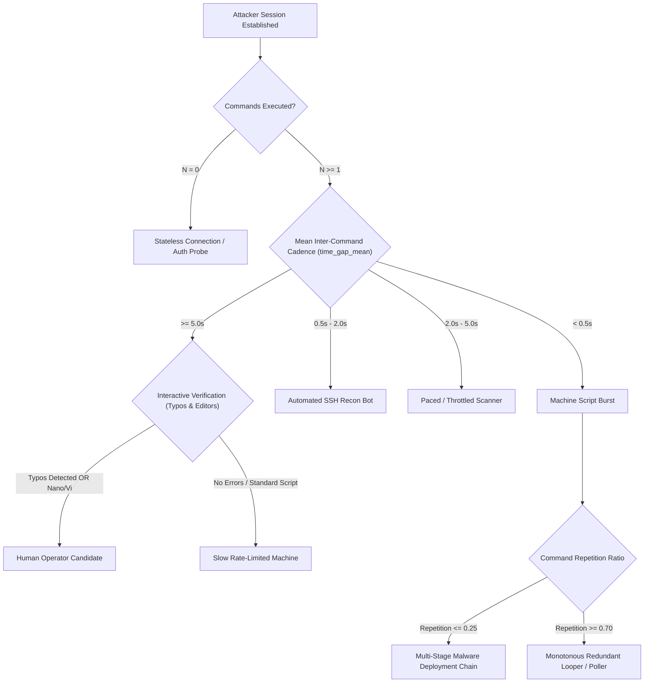

# Honeypot Data Analysis & Threat Intelligence Report

**Innovation Lab 3 — FH Technikum Wien | Team 11**
Analysis Period: **2026-01-07 to 2026-10-23** · Total Unified Events: **44,148,297** · Generated: 2026-10-30 22:32

---

## Key Findings

- **44,148,297 events** from 4 honeypot types between 2026-01-07 to 2026-10-23.
- **259,946 Cowrie sessions contain typed commands** (124,147 with 2 or more). These are the usable units for clustering.
- Behavior is highly repetitive: only **3,913 distinct command sequences** (98.49% exact duplicates). After masking URLs, IPs and secrets, **767 command families** remain and the top 10 families cover **95.43%** of all command sessions.
- In a time-based 70/30 split, **17.01% of later sessions use a command family never seen before**. This is the part where ML can add value beyond exact matching.
- Burst-speed sessions: **93.32%** in the sessions table, **44.82%** when only real typed commands are counted (see 6.3).
- **11** of 61,063 candidate sessions show human signals (typos, editors, corrections). Almost all traffic is automated.
- **27.71%** of Cowrie login attempts succeed (honeypot accepts weak credentials by design).

---

## 1. Data Ingestion & Quality

### Data Volume Per Honeypot Sensor

| Honeypot | Sensor Type | Total Events | Unique Source IPs | Active Period |
|:---|:---|---:|---:|:---|
| **Cowrie** | SSH / Telnet Honeypot | 17,331,809 | 36,332 | 2026-01-07 to 2026-10-22 |
| **Heralding** | Credential Harvester | 26,486,528 | 71,034 | 2026-04-01 to 2026-10-23 |
| **Nginx** | HTTP Honeypot | 322,870 | 12,932 | 2026-04-08 to 2026-10-23 |
| **Endlessh** | SSH Tarpit | 7,090 | 981 | 2026-03-29 to 2026-10-22 |
| **Total** | **Unified Dataset** | **44,148,297** | **—** | **2026-01-07 to 2026-10-23** |

---

### Geographic Distribution of Attacks (Top 10 Source Countries)

| Country | Total Attacks | Share | Visual Distribution |
|:---:|---:|---:|:---|
| `US` | 11,681,852 | 26.5% | `████░░░░░░░░░░░░` |
| `DE` | 10,263,587 | 23.28% | `████░░░░░░░░░░░░` |
| `CN` | 2,474,926 | 5.61% | `█░░░░░░░░░░░░░░░` |
| `BG` | 2,221,482 | 5.04% | `█░░░░░░░░░░░░░░░` |
| `LT` | 1,741,009 | 3.95% | `█░░░░░░░░░░░░░░░` |
| `SG` | 1,726,402 | 3.92% | `█░░░░░░░░░░░░░░░` |
| `RO` | 1,159,489 | 2.63% | `░░░░░░░░░░░░░░░░` |
| `BR` | 967,526 | 2.19% | `░░░░░░░░░░░░░░░░` |
| `GB` | 854,500 | 1.94% | `░░░░░░░░░░░░░░░░` |
| `VN` | 830,526 | 1.88% | `░░░░░░░░░░░░░░░░` |

---

### Signal vs. Noise Ratio

- Actionable events by sensor (authentication attempts, commands, payloads):
  - **Cowrie**: 9,441,213 actionable events (54.47%).
  - **Heralding**: 9,238,653 actionable events (34.88%).
  - **Nginx**: 322,870 actionable events (100.0%).
  - **Endlessh**: 0 actionable events (0.0%).

- Noise events (connections without credentials or payload):

| Honeypot | Noise Events (`connection_established`) | Total Volume | Noise Ratio | Visual Noise Share |
|:---|---:|---:|---:|:---|
| **Endlessh** | 7,090 | 7,090 | **100.0%** | `████████████████` |
| **Heralding** | 17,247,875 | 26,486,528 | **65.12%** | `██████████░░░░░░` |
| **Cowrie** | 7,859,889 | 17,331,809 | **45.35%** | `███████░░░░░░░░░` |
| **Nginx** | 0 | 322,870 | **0.0%** | `░░░░░░░░░░░░░░░░` |

- Integrity: `null_src_ip` = 0, `null_timestamp` = 0, `null_sensor_type` = 0, `null_category` = 0.

---

## 2. Attacker Behavioral Dynamics & Session Intelligence

Five session-level metrics from the `sessions` table (`command_count`, `unique_command_count`, `session_duration`, `time_gap_mean`, `repetition_ratio`) describe how attackers interact with the shell.

### 2.1 Attacker Typing Cadence (Machine Script vs. Human Pace)

Mean time between commands (`time_gap_mean`) separates scripts from interactive operators:

| Cadence Tier | Share | Visual Share | Sessions | Avg Commands | Avg Duration | Typical Meaning |
|:---|---:|:---|---:|---:|---:|:---|
| **Burst Script (< 0.5s)** | **93.32%** | `███████████░` | 3,329,363 | 2.14 | 3.28s | Commands sent faster than a person can type (scripted loaders) |
| **Fast Bot Recon (0.5s - 2.0s)** | **4.95%** | `█░░░░░░░░░░░` | 176,528 | 3.43 | 6.02s | Bots that wait for each prompt before sending the next command |
| **Paced Script (2.0s - 5.0s)** | **0.47%** | `░░░░░░░░░░░░` | 16,764 | 2.76 | 14.49s | Throttled scripts or slow network paths |
| **Human Interactive Pace (>= 5.0s)** | **0.3%** | `░░░░░░░░░░░░` | 10,829 | 2.29 | 38.51s | Typing pace of a person, or scripts with sleeps |
| **Single Command / No Gap** | **0.95%** | `░░░░░░░░░░░░` | 34,038 | 1.0 | 51.82s | Only one command, no gap measurable |

> [!NOTE]
> **93.32% of sessions with commands** (3,329,363 sessions) average less than 0.5 seconds between commands. No person types that fast, so these are scripts. Section 6.3 checks how much of this comes from non-command client events.

---

### 2.2 Attacker Behavioral Archetypes (Complexity vs. Redundancy)

Command volume, diversity and repetition ratio ($R = 1 - \text{unique}/\text{total}$) split sessions into five rule-based archetypes:

| Archetype | Share | Visual Share | Sessions | Avg Cmds | Unique Cmds | Avg Duration | Typical Meaning |
|:---|---:|:---|---:|---:|---:|---:|:---|
| **1. Single-Command Probe** | **0.95%** | `░░░░░░░░░░░░` | 34,038 | 1.0 | 1.0 | 51.82s | One check or one-liner payload, then disconnect |
| **2. Multi-Stage Diverse Malware Chain** | **3.41%** | `░░░░░░░░░░░░` | 121,811 | 6.4 | 5.38 | 5.79s | Many different commands: recon, download, execute |
| **3. Monotonous Redundant Looper** | **0.21%** | `░░░░░░░░░░░░` | 7,416 | 7.0 | 1.0 | 0.9s | Same commands repeated, polling or broken loops |
| **4. Standard Automated Recon** | **95.29%** | `███████████░` | 3,399,363 | 2.04 | 1.04 | 3.49s | Typical bot script with some repetition |
| **5. Brief Interaction (2-4 Cmds)** | **0.14%** | `░░░░░░░░░░░░` | 4,894 | 4.0 | 1.77 | 10.74s | Short scripted check |

---

### 2.3 Behavioral Decision Architecture

The rule-based decision workflow used for the cadence and archetype tables:



---

### 2.4 Top Multi-Stage Complex Attack Sessions

Sessions with the highest number of distinct commands:

| Session ID | Sensor | Source IP | Country | Total Cmds | Unique Cmds | Repetition | Cadence | Duration | Archetype |
|:---|:---:|:---|:---:|---:|---:|---:|---:|---:|:---|
| `c101c1b99c41` | `cowrie` | `45.78.219.184` | SG | 24 | **23** | 4.2% | 2.0336s | 46.935202s | Many different commands: recon, download, execute |
| `2ece44b957c9` | `cowrie` | `219.151.181.185` | CN | 24 | **23** | 4.2% | 1.623s | 37.58246s | Many different commands: recon, download, execute |
| `1512297b5142` | `cowrie` | `180.153.91.15` | CN | 24 | **23** | 4.2% | 1.516s | 36.456655s | Many different commands: recon, download, execute |
| `d483b75208ac` | `cowrie` | `180.106.83.59` | CN | 24 | **23** | 4.2% | 1.2116s | 28.795524s | Many different commands: recon, download, execute |
| `0e2f83e5fca2` | `cowrie` | `45.78.194.186` | SG | 22 | **21** | 4.5% | 1.4102s | 301.629663s | Many different commands: recon, download, execute |
| `2a78594317ba` | `cowrie` | `64.181.175.157` | US | 22 | **21** | 4.5% | 11.5575s | 246.002145s | Many different commands: recon, download, execute |
| `0aa11b6f9b66` | `cowrie` | `14.103.178.199` | CN | 22 | **21** | 4.5% | 10.7153s | 227.38731s | Many different commands: recon, download, execute |
| `084c43ee425a` | `cowrie` | `46.191.141.152` | RU | 22 | **21** | 4.5% | 8.2672s | 175.115571s | Many different commands: recon, download, execute |
| `51cafab551a2` | `cowrie` | `46.191.141.152` | RU | 22 | **21** | 4.5% | 7.8931s | 166.566445s | Many different commands: recon, download, execute |
| `91be50ea7477` | `cowrie` | `172.178.16.179` | GB | 22 | **21** | 4.5% | 7.6425s | 164.659972s | Many different commands: recon, download, execute |

---

### 2.5 High-Velocity Sub-Second Attack Bursts

Sessions that send at least five commands with less than 0.5 seconds between them:

| Session ID | Source IP | Country | Commands Executed | Total Duration | Mean Cadence | Archetype |
|:---|:---|:---:|---:|---:|---:|:---|
| `b2f88d010e6a` | `62.210.189.225` | FR | 7 cmds | 0.022769s | **0.0033s** | Same commands repeated, polling or broken loops |
| `1ba47ce3f481` | `62.210.189.225` | FR | 7 cmds | 0.023456s | **0.0034s** | Same commands repeated, polling or broken loops |
| `25aedfa0dfec` | `62.210.246.122` | FR | 7 cmds | 0.023972s | **0.0034s** | Same commands repeated, polling or broken loops |
| `596fefe6ee70` | `62.210.189.225` | FR | 7 cmds | 0.023719s | **0.0034s** | Same commands repeated, polling or broken loops |
| `e21994072c5b` | `62.210.189.225` | FR | 7 cmds | 0.023905s | **0.0035s** | Same commands repeated, polling or broken loops |
| `e49e78b8085e` | `62.210.207.172` | FR | 7 cmds | 0.0238s | **0.0035s** | Same commands repeated, polling or broken loops |
| `0f324f5b72db` | `62.210.189.225` | FR | 7 cmds | 0.025083s | **0.0036s** | Same commands repeated, polling or broken loops |
| `11738262253a` | `62.210.189.225` | FR | 7 cmds | 0.024756s | **0.0036s** | Same commands repeated, polling or broken loops |
| `213c629be292` | `62.210.246.122` | FR | 7 cmds | 0.024653s | **0.0036s** | Same commands repeated, polling or broken loops |
| `26e507f5febd` | `62.210.189.225` | FR | 7 cmds | 0.024586s | **0.0036s** | Same commands repeated, polling or broken loops |

---

## 3. Human / Manual Attack Verification

### Human Session Candidates

A multi-signal filter looks for real typing errors (`sudp`, `sl`, `cd /ect`, `whomi`, `gerp`), interactive editors (`nano`/`vi`) and quick corrections within 0.4 to 8 seconds. Confidence counts how many of these three signal types are present. A flag is a candidate for manual review, not proof of a human.

| Session ID | Source IP | Country | Duration | Mean Command Gap | Confidence | Signals |
|:---|:---|:---:|---:|---:|:---:|:---|
| `a42bad2e2771` | `178.191.188.22` | AT | 215s | **11.33s** | `3 / 3` | Human Typos Detected + Interactive Editor Usage + Natural Stumbles & Quick Retries ('sudp apt update' -> 'sudo apt update' (5.0s)) |
| `e426f73a83b9` | `178.191.186.131` | AT | 156s | **8.65s** | `2 / 3` | Interactive Editor Usage + Natural Stumbles & Quick Retries ('cd ..' followed by 'ls' (1.2s), 'cd ..' followed by 'ls' (0.7s)) |
| `f634e8e08b63` | `167.71.115.113` | US | 9s | **1.28s** | `1 / 3` | Natural Stumbles & Quick Retries ('last -n 3 2>/dev/null \| head -3' -> 'cat /etc/issue 2>/dev/null' (3.0s)) |
| `204888a8f4ef` | `167.71.115.113` | US | 7s | **0.97s** | `1 / 3` | Natural Stumbles & Quick Retries ('ssh -V' -> 'ps aux \| head -15' (0.8s)) |
| `0d9d88aa5ac4` | `167.71.115.113` | US | 6s | **0.88s** | `1 / 3` | Natural Stumbles & Quick Retries ('last -n 3 2>/dev/null \| head -3' -> 'cat /etc/issue 2>/dev/null' (0.9s)) |
| `c89c921595d6` | `167.71.115.113` | US | 6s | **0.85s** | `1 / 3` | Natural Stumbles & Quick Retries ('last -n 3 2>/dev/null \| head -3' -> 'cat /etc/os-release 2>/dev/null \| head -6' (1.5s)) |
| `0909b21967d9` | `167.71.115.113` | US | 6s | **0.82s** | `1 / 3` | Natural Stumbles & Quick Retries ('ssh -V' -> 'ls -la /' (0.9s)) |
| `0c2d42bb2f35` | `167.71.115.113` | US | 5s | **0.74s** | `1 / 3` | Natural Stumbles & Quick Retries ('last -n 3 2>/dev/null \| head -3' -> 'cat /etc/issue 2>/dev/null' (1.1s), 'df -h / 2>/dev/null \| tail -1' -> 'ls /dev \| wc -l' (0.8s)) |
| `374c5eab087e` | `167.71.115.113` | US | 5s | **0.65s** | `1 / 3` | Natural Stumbles & Quick Retries ('last -n 3 2>/dev/null \| head -3' -> 'ls /var/log 2>/dev/null \| wc -l' (0.7s)) |
| `43f901b54e75` | `167.71.115.113` | US | 4s | **0.53s** | `1 / 3` | Natural Stumbles & Quick Retries ('last -n 3 2>/dev/null \| head -3' -> 'ls /dev \| wc -l' (0.6s)) |
| `ed5e740fcab9` | `167.71.115.113` | US | 2s | **0.33s** | `1 / 3` | Natural Stumbles & Quick Retries ('df -h / 2>/dev/null \| tail -1' -> 'ls /opt 2>/dev/null' (0.6s)) |

#### Session `a42bad2e2771` Timeline (`178.191.188.22`)
- **Duration:** 215 seconds · **Average Gap:** 11.33s
- **Raw Commands Executed:**
```bash
cat /proc/cpuinfo
id
ls
whoami
uname -a
ls
mkdir test
ls
nano lol.txt
sudo nano lol.sh
sudp apt update
sudp apt update
sudo apt update
ls
touch test
ls
touch test2
ls
tail test2
exit
```

#### Session `e426f73a83b9` Timeline (`178.191.186.131`)
- **Duration:** 156 seconds · **Average Gap:** 8.65s
- **Raw Commands Executed:**
```bash
pwd
whoami
echo test
ls -la
ls
cd ..
ls
cd ..
ls
ls var
ls usr
ls etc
nano etc/passwwd
nano etc/passwwd
touch etc/passwd
cd etc
ls
cat passwd
cat motd
```

#### Session `f634e8e08b63` Timeline (`167.71.115.113`)
- **Duration:** 9 seconds · **Average Gap:** 1.28s
- **Raw Commands Executed:**
```bash
grep 'model name' /proc/cpuinfo 2>/dev/null | head -1
last -n 3 2>/dev/null | head -3
cat /etc/issue 2>/dev/null
ls -la /
pwd
cat /proc/version 2>/dev/null
cat /etc/os-release 2>/dev/null | head -6
ls /var/log 2>/dev/null | wc -l
```

#### Session `204888a8f4ef` Timeline (`167.71.115.113`)
- **Duration:** 7 seconds · **Average Gap:** 0.97s
- **Raw Commands Executed:**
```bash
ls /opt 2>/dev/null
ssh -V
ps aux | head -15
uptime
history | tail -5
mount | head -5
env | head -10
cat /proc/version 2>/dev/null
```

#### Session `0d9d88aa5ac4` Timeline (`167.71.115.113`)
- **Duration:** 6 seconds · **Average Gap:** 0.88s
- **Raw Commands Executed:**
```bash
ssh -V
grep MemTotal /proc/meminfo 2>/dev/null
ps aux | head -15
cat /etc/os-release 2>/dev/null | head -6
history | tail -5
grep 'model name' /proc/cpuinfo 2>/dev/null | head -1
last -n 3 2>/dev/null | head -3
cat /etc/issue 2>/dev/null
```

#### Session `c89c921595d6` Timeline (`167.71.115.113`)
- **Duration:** 6 seconds · **Average Gap:** 0.85s
- **Raw Commands Executed:**
```bash
grep 'model name' /proc/cpuinfo 2>/dev/null | head -1
ls /var/log 2>/dev/null | wc -l
cat /etc/issue 2>/dev/null
uptime
last -n 3 2>/dev/null | head -3
cat /etc/os-release 2>/dev/null | head -6
ls /dev | wc -l
crontab -l 2>/dev/null | head -5
```

#### Session `0909b21967d9` Timeline (`167.71.115.113`)
- **Duration:** 6 seconds · **Average Gap:** 0.82s
- **Raw Commands Executed:**
```bash
hostname
df -h / 2>/dev/null | tail -1
grep 'model name' /proc/cpuinfo 2>/dev/null | head -1
ssh -V
ls -la /
ls /opt 2>/dev/null
pwd
uname -a
```

#### Session `0c2d42bb2f35` Timeline (`167.71.115.113`)
- **Duration:** 5 seconds · **Average Gap:** 0.74s
- **Raw Commands Executed:**
```bash
ls /var/log 2>/dev/null | wc -l
whoami
last -n 3 2>/dev/null | head -3
cat /etc/issue 2>/dev/null
cat /etc/os-release 2>/dev/null | head -6
df -h / 2>/dev/null | tail -1
ls /dev | wc -l
cat /proc/version 2>/dev/null
```

#### Session `374c5eab087e` Timeline (`167.71.115.113`)
- **Duration:** 5 seconds · **Average Gap:** 0.65s
- **Raw Commands Executed:**
```bash
cat /proc/version 2>/dev/null
ls /opt 2>/dev/null
hostname
history | tail -5
cat /etc/issue 2>/dev/null
uname -a
last -n 3 2>/dev/null | head -3
ls /var/log 2>/dev/null | wc -l
```

#### Session `43f901b54e75` Timeline (`167.71.115.113`)
- **Duration:** 4 seconds · **Average Gap:** 0.53s
- **Raw Commands Executed:**
```bash
grep MemTotal /proc/meminfo 2>/dev/null
ls /opt 2>/dev/null
last -n 3 2>/dev/null | head -3
ls /dev | wc -l
ls /var/log 2>/dev/null | wc -l
whoami
uptime
mount | head -5
```

*1 further flagged sessions are listed in analyzer_results.json.*

---

## 4. Cross-Sensor Correlation

### Attacker Infrastructure Overlap

| Honeypot Sensors Hit | Number of Unique IPs | Infrastructure Breadth |
|:---:|---:|:---|
| **4 sensors** | **216 IPs** | `Broad Multi-Vector Targeter` |
| **3 sensors** | **2,176 IPs** | `Broad Multi-Vector Targeter` |
| **2 sensors** | **15,868 IPs** | `Dual-Vector Scanner` |
| **1 sensors** | **82,151 IPs** | `Specialized Scanner` |

### Top Multi-Sensor Attackers

| Attacker Source IP | Country | Sensors Hit | Sensors | Total Events | First Seen | Last Seen |
|:---|:---:|:---:|:---|---:|:---|:---|
| `172.235.168.35` | US | 4 | `cowrie,endlessh,heralding,nginx` | 3,471 | 2026-01-13 | 2026-07-24 |
| `88.214.25.125` | DE | 4 | `cowrie,endlessh,heralding,nginx` | 1,048 | 2026-01-22 | 2026-10-19 |
| `45.91.64.7` | RU | 4 | `cowrie,endlessh,heralding,nginx` | 886 | 2026-01-16 | 2026-10-17 |
| `88.214.25.123` | DE | 4 | `cowrie,endlessh,heralding,nginx` | 871 | 2026-01-16 | 2026-10-22 |
| `194.165.16.166` | PA | 4 | `cowrie,endlessh,heralding,nginx` | 839 | 2026-01-09 | 2026-10-09 |
| `194.165.16.163` | PA | 4 | `cowrie,endlessh,heralding,nginx` | 807 | 2026-02-25 | 2026-09-27 |
| `194.165.16.123` | PA | 4 | `cowrie,endlessh,heralding,nginx` | 730 | 2026-07-27 | 2026-09-28 |
| `95.215.0.144` | RU | 4 | `cowrie,endlessh,heralding,nginx` | 725 | 2026-01-08 | 2026-09-02 |
| `194.165.16.165` | PA | 4 | `cowrie,endlessh,heralding,nginx` | 700 | 2026-02-16 | 2026-09-26 |
| `194.165.16.161` | PA | 4 | `cowrie,endlessh,heralding,nginx` | 664 | 2026-01-17 | 2026-09-23 |

---

## 5. Signature Analysis: The `mdrfckr` Campaign

The most persistent SSH backdoor pattern in the dataset carries the string **`mdrfckr`** (the comment of an attacker SSH key written to `authorized_keys`):
- **Total Payload Hits:** **63,978**
- **Distinct Attacking IPs:** **5,618**
- **Active:** 2026-01-08 to 2026-09-14

| Most Frequent Variants | Hits | IPs |
|:---|---:|---:|
| `cd ~ && rm -rf .ssh && mkdir .ssh && echo "ssh-rsa AAAAB3NzaC1yc2EAAAABJQAAAQEArDp4cun2lhr4KUhBGE7VvAcwdli2a8dbnrTOrbMz1+5O73fcBOx8NVbUT0bUanUV9tJ2/9p7+vD0EpZ3…` | 63,977 | 5,617 |
| `dev:mdrfckr2!@#0ooZShh**` | 1 | 1 |

| Top Deploying IP | Hits | First | Last |
|:---|---:|:---|:---|
| `189.50.142.82` | 171 | 2026-01-16 | 2026-02-21 |
| `102.88.137.80` | 167 | 2026-01-08 | 2026-03-29 |
| `102.88.137.213` | 165 | 2026-01-08 | 2026-03-23 |
| `181.116.220.140` | 164 | 2026-01-14 | 2026-03-18 |
| `187.16.96.250` | 146 | 2026-01-08 | 2026-03-30 |

---

## 6. ML Readiness & Data Quality (Innovation Lab 3)

The supervisor's criteria for good ML data are diversity, few duplicates and multiple attack vectors. This section measures exactly that for the planned unit of analysis: one Cowrie session with typed commands.

### 6.1 Dataset Size

| Measure | Value |
|:---|---:|
| Cowrie sessions in `sessions` table | 3,706,172 |
| Sessions without typed commands (excluded) | 3,446,226 |
| Sessions with >= 1 typed command | **259,946** |
| Sessions with >= 2 typed commands | **124,147** |
| Command events | 677,408 |
| ... of type `cowrie.command.input` | 545,177 (80.48%) |
| `raw_data` truncated at 1,000 chars | 122,273 (18.05%) |

### 6.2 Diversity vs. Duplicates

| Measure | All command sessions | Sessions with >= 2 commands |
|:---|---:|---:|
| Sessions | 259,946 | 124,147 |
| Distinct exact command sequences | 3,913 | 3,610 |
| Distinct command families (templates) | 767 | 673 |
| Exact duplicate share | 98.49% | — |
| Family duplicate share | 99.7% | — |
| Share covered by top 10 families | 95.43% | — |
| Families seen in only one session | 583 | — |

> [!NOTE]
> A **command family** is a command sequence after masking URLs, IP addresses, quoted secrets, long random tokens and numbers. Exact matching corresponds to the Innovation Lab 2 method. Families are a transparent rule baseline that an ML clustering must beat to show added value.

### 6.3 Cadence Check: Sessions Table vs. Real Commands

The `sessions` table was built with session metrics v1, which also counted `cowrie.client.*` events (SSH version, key exchange, terminal size). These arrive within milliseconds at connection start and push sessions into the burst tier. Re-running normalizer.py recomputes the table (v2). The right column only uses typed commands:

| Cadence Tier | Sessions Table | Real Commands Only | Sessions (Real) | Avg Cmds (Real) |
|:---|---:|---:|---:|---:|
| Burst Script (< 0.5s) | 93.32% | **44.82%** | 116,508 | 4.0 |
| Fast Bot Recon (0.5s - 2.0s) | 4.95% | **2.6%** | 6,750 | 9.78 |
| Paced Script (2.0s - 5.0s) | 0.47% | **0.24%** | 619 | 11.97 |
| Human Interactive Pace (>= 5.0s) | 0.3% | **0.1%** | 270 | 6.91 |
| Single Command / No Gap | 0.95% | **52.24%** | 135,799 | 1.0 |

- Sessions table: 3,567,522 Cowrie sessions with `command_count > 0`. Real typed commands exist in 259,946.

---

## 7. Command Families (Template Baseline)

The 15 most frequent command families. *Variants* shows how many different exact sequences were merged into one family. A high value means exact matching would split one bot script into many groups.

| # | Command Family (masked) | Sessions | Share | IPs | Variants | Active Days | Cmds | Intent Profile | First | Last |
|---:|:---|---:|---:|---:|---:|---:|---:|:---|:---|:---|
| 1 | `echo -e <STR>` | 110,560 | 42.53% | 12 | 1 | 13 | 1 | unclassified | 2026-01-09 | 2026-03-19 |
| 2 | `cd ~; chattr -ia .ssh; lockr -ia .ssh ; lockr -ia .ssh ; cd ~ && rm -rf .ssh && mkdir .ssh && echo "ssh-rsa <…` | 60,766 | 23.38% | 5,306 | 1 | 83 | 3 | persistence+cleanup_evasion | 2026-01-08 | 2026-03-31 |
| 3 | `export PATH=/usr/local/sbin:/usr/local/bin:/usr/sbin:/usr/bin:/sbin:/bin:$PATH; uname=$(uname -s -v -n -m <N>…` | 42,028 | 16.17% | 1,581 | 1 | 47 | 5 | recon | 2026-01-07 | 2026-02-23 |
| 4 | `export PATH=/usr/local/sbin:/usr/local/bin:/usr/sbin:/usr/bin:/sbin:/bin:$PATH; uname=$(uname -s -v -n -m <N>…` | 12,713 | 4.89% | 959 | 1 | 33 | 5 | recon | 2026-02-23 | 2026-03-31 |
| 5 | `uname -s -v -n -r -m` | 11,317 | 4.35% | 176 | 1 | 62 | 1 | recon | 2026-01-08 | 2026-03-29 |
| 6 | `cd ~; chattr -ia .ssh; lockr -ia .ssh ; lockr -ia .ssh ; cd ~ && rm -rf .ssh && mkdir .ssh && echo "ssh-rsa <…` | 2,640 | 1.02% | 1,152 | 2,639 | 77 | 20 | recon+execute+persistence+cleanup_evasion | 2026-01-08 | 2026-03-31 |
| 7 | `/bin/./uname -s -v -n -r -m` | 2,459 | 0.95% | 30 | 1 | 79 | 1 | recon | 2026-01-08 | 2026-03-31 |
| 8 | `uname -a;id;cat /etc/shadow /etc/passwd;lscpu;echo 'daemon ALL=(ALL) NOPASSWD: ALL' >> /etc/sudoers;chsh -s /…` | 2,209 | 0.85% | 2 | 1 | 5 | 6 | recon+download+execute+persistence+cleanup_evasion | 2026-01-22 | 2026-02-08 |
| 9 | `uname -a` | 1,868 | 0.72% | 89 | 1 | 47 | 1 | recon | 2026-01-11 | 2026-03-28 |
| 10 | `hostname` | 1,518 | 0.58% | 68 | 1 | 41 | 1 | recon | 2026-01-10 | 2026-03-31 |
| 11 | `uname -a ; nproc <N>>/dev/null \|\| echo <N>` | 991 | 0.38% | 1 | 1 | 1 | 2 | recon | 2026-02-17 | 2026-02-17 |
| 12 | `whoami` | 921 | 0.35% | 57 | 1 | 38 | 1 | recon | 2026-01-11 | 2026-03-28 |
| 13 | `pwd` | 713 | 0.27% | 53 | 1 | 36 | 1 | unclassified | 2026-01-11 | 2026-03-20 |
| 14 | `ls -la /` | 596 | 0.23% | 55 | 1 | 33 | 1 | unclassified | 2026-01-11 | 2026-03-06 |
| 15 | `ps aux \| head -<N>` | 520 | 0.2% | 56 | 2 | 31 | 1 | recon | 2026-01-11 | 2026-03-03 |

---

## 8. Rule-Based Intent Baseline

Each session gets every intent tag whose indicator appears in its commands. A session can have several tags. These tags are heuristics for comparison with ML clusters, not ground truth labels.

| Intent | Sessions | Share | Visual Share | Indicators |
|:---|---:|---:|:---|:---|
| **recon** | 83,435 | 32.1% | `████░░░░░░░░` | System fingerprinting (uname, /proc/cpuinfo, nproc, free ...) |
| **download** | 2,810 | 1.08% | `░░░░░░░░░░░░` | Fetching tools or malware (wget, curl, tftp, /dev/tcp) |
| **execute** | 6,969 | 2.68% | `░░░░░░░░░░░░` | Making files executable or running them (chmod +x, ./x, \| sh) |
| **persistence** | 67,415 | 25.93% | `███░░░░░░░░░` | Keeping access (authorized_keys, crontab, chpasswd, useradd) |
| **cleanup_evasion** | 67,947 | 26.14% | `███░░░░░░░░░` | Hiding traces or removing competitors (history -c, rm -rf, pkill, iptables) |
| **cryptomining** | 2 | 0.0% | `░░░░░░░░░░░░` | Miner indicators (xmrig, stratum+tcp, c3pool, kinsing) |
| **iot_botnet_probe** | 0 | 0.0% | `░░░░░░░░░░░░` | Mirai-style busybox checks (/bin/busybox XXXX) |

### 8.1 Most Common Intent Combinations (Kill-Chain Profiles)

| Profile | Sessions | Share |
|:---|---:|---:|
| `unclassified` | 114,556 | 44.07% |
| `recon` | 76,545 | 29.45% |
| `persistence+cleanup_evasion` | 60,797 | 23.39% |
| `recon+execute+persistence+cleanup_evasion` | 3,578 | 1.38% |
| `recon+download+execute+persistence+cleanup_evasion` | 2,539 | 0.98% |
| `execute` | 391 | 0.15% |
| `recon+cleanup_evasion` | 294 | 0.11% |
| `cleanup_evasion` | 285 | 0.11% |
| `recon+persistence+cleanup_evasion` | 244 | 0.09% |
| `persistence` | 211 | 0.08% |
| `download+execute+cleanup_evasion` | 193 | 0.07% |
| `recon+execute` | 177 | 0.07% |

---

## 9. Temporal Novelty & Time-Based Split

*Novel sessions* use a command family that first appeared in that month. A falling novelty rate means the honeypots mostly collect repetitions of known behavior.

| Month | Command Sessions | >= 2 Cmds | Families | New Families | Novel Sessions | Cumulative |
|:---|---:|---:|---:|---:|---:|---:|
| 2026-01 | 113,460 | 36,199 | 425 | 425 | 100.0% | 43.65% |
| 2026-02 | 124,790 | 73,204 | 212 | 111 | 3.64% | 91.65% |
| 2026-03 | 21,696 | 14,744 | 275 | 231 | 2.09% | 100.0% |

### 9.1 Suggested Train / Test Split (chronological, no shuffling)

| Part | Sessions | Period |
|:---|---:|:---|
| Train (first 70%) | 181,962 | 2026-01-07 to 2026-02-17 |
| Test (last 30%) | 77,984 | 2026-02-17 to 2026-03-31 |

- Cutoff: `2026-02-17T18:30:30.272950Z`.
- **13,264 test sessions (17.01%)** use one of 268 families that never occur in the training period. A random split would hide this and make results look better than they are.
- The test part is also the "last 30% of the data" the supervisor suggested for a first clustering run on a laptop.

---

## 10. Attacker Recurrence

Do the same source IPs come back, and do they always run the same script?

9,252 IPs ran at least one command session.

| Active Days per IP | IPs | Share |
|:---|---:|---:|
| 1 day | 5,620 | 60.74% |
| 2-7 days | 3,066 | 33.14% |
| 8-30 days | 558 | 6.03% |
| > 30 days | 8 | 0.09% |

| Command Families per IP | IPs | Share |
|:---|---:|---:|
| 1 template | 7,991 | 86.37% |
| 2-3 templates | 1,080 | 11.67% |
| 4+ templates | 181 | 1.96% |

### 10.1 Most Persistent IPs

| Source IP | Country | Active Days | Sessions | Families | First Seen | Last Seen |
|:---|:---:|---:|---:|---:|:---|:---|
| `130.12.180.51` | US | 76 | 332 | 1 | 2026-01-08 | 2026-03-30 |
| `92.118.39.95` | RO | 57 | 648 | 1 | 2026-01-08 | 2026-03-31 |
| `213.209.159.158` | DE | 46 | 102 | 1 | 2026-01-08 | 2026-03-29 |
| `2.57.122.210` | RO | 44 | 264 | 1 | 2026-01-08 | 2026-03-31 |
| `91.92.241.59` | TR | 42 | 177 | 1 | 2026-01-08 | 2026-02-21 |
| `193.32.162.145` | RO | 42 | 110 | 1 | 2026-01-08 | 2026-03-31 |
| `80.94.92.182` | RO | 35 | 153 | 1 | 2026-01-24 | 2026-03-31 |
| `92.118.39.92` | RO | 32 | 746 | 1 | 2026-01-09 | 2026-03-09 |
| `102.88.137.80` | NG | 29 | 167 | 1 | 2026-01-08 | 2026-03-29 |
| `193.32.162.157` | RO | 28 | 70 | 1 | 2026-01-08 | 2026-02-07 |

---

## 11. Cowrie Login Funnel & SSH Client Fingerprints

| Stage | Count |
|:---|---:|
| Cowrie sessions (any) | 3,706,172 |
| Login attempts | 1,235,530 |
| Successful logins | 342,417 |
| Sessions with typed commands | 259,946 |
| Sessions with >= 2 commands | 124,147 |
| Sessions with download attempt | 2,810 |
| Sessions with execute attempt | 6,969 |
| Sessions flagged human | 11 |

### 11.1 Credentials That Led to a Shell

| Credential | Successful Logins | Attempts | IPs |
|:---|---:|---:|---:|
| `root:3245gs5662d34` | 60,948 | 60,948 | 5,308 |
| `root:admin` | 4,023 | 4,029 | 2,054 |
| `root:password` | 3,915 | 3,919 | 2,267 |
| `root:12345` | 3,113 | 3,118 | 1,982 |
| `root:qwerty` | 2,754 | 2,757 | 1,811 |
| `root:12345678` | 2,723 | 2,726 | 1,725 |
| `root:root123` | 2,689 | 2,694 | 1,720 |
| `root:1234` | 2,655 | 2,656 | 1,673 |
| `root:123456789` | 2,560 | 2,563 | 1,706 |
| `root:admin123` | 2,443 | 2,445 | 1,224 |

### 11.2 SSH Client Versions (Bot Tooling)

The SSH client banner shows which libraries bots are built with (e.g. Go, libssh, paramiko) and is a useful clustering feature.

| Client Version | Connections | Share | IPs |
|:---|---:|---:|---:|
| `SSH-2.0-Go` | 2,338,666 | 65.55% | 9,221 |
| `SSH-2.0-libssh_0.11.1` | 669,011 | 18.75% | 7,847 |
| `SSH-2.0-libssh_0.9.6` | 180,435 | 5.06% | 3,849 |
| `SSH-2.0-libssh2_1.11.1` | 161,481 | 4.53% | 1,066 |
| `SSH-2.0-RawPasswordConnectOnly_3.0_net10` | 24,792 | 0.69% | 908 |
| `SSH-2.0-libssh_0.12.0` | 24,275 | 0.68% | 821 |
| `SSH-2.0-AsyncSSH_2.1.0` | 20,822 | 0.58% | 612 |
| `SSH-2.0-libssh2_1.11.0` | 20,152 | 0.56% | 802 |
| `SSH-2.0-OpenSSH_7.4` | 17,164 | 0.48% | 2,567 |
| `SSH-2.0-RawPasswordConnectOnly_1.0` | 16,675 | 0.47% | 2,167 |
| `SSH-2.0-libssh2_1.9.0` | 16,361 | 0.46% | 10 |
| `SSH-2.0-libssh2_1.4.3` | 10,202 | 0.29% | 8 |
| `SSH-2.0-libssh_0.9.8` | 8,631 | 0.24% | 1 |
| `SSH-2.0-PuTTY_Release_0.84` | 8,353 | 0.23% | 6 |
| `SSH-2.0-libssh_0.10.6` | 6,059 | 0.17% | 6 |

---

## 12. Brute-Force Credentials

| Top Credential Pairs (all sensors) | Attempts | IPs | Sensors |
|:---|---:|---:|:---|
| `:` | 3,943,037 | 1,949 | `cowrie,heralding` |
| `enable:linuxshell` | 961,409 | 559 | `heralding` |
| `system:shell` | 894,578 | 956 | `heralding` |
| `enable:system` | 185,640 | 7,804 | `heralding` |
| `shell:sh` | 169,257 | 7,113 | `heralding` |
| `root:xc3511` | 85,519 | 1,800 | `cowrie,heralding` |
| `root:` | 79,138 | 2,712 | `cowrie,heralding` |
| `root:vizxv` | 77,690 | 1,801 | `cowrie,heralding` |
| `admin:admin` | 73,602 | 7,357 | `cowrie,heralding` |
| `root:admin` | 71,312 | 4,190 | `cowrie,heralding` |
| `345gs5662d34:345gs5662d34` | 61,069 | 5,308 | `cowrie,heralding` |
| `root:3245gs5662d34` | 60,949 | 5,309 | `cowrie,heralding` |
| `root:888888` | 48,849 | 1,013 | `cowrie,heralding` |
| `root:root` | 48,388 | 7,982 | `cowrie,heralding` |
| `root:123456` | 47,843 | 4,548 | `cowrie,heralding` |

| Mirai Default Credential | Attempts | IPs |
|:---|---:|---:|
| `root:xc3511` | 85,519 | 1,800 |
| `root:vizxv` | 77,690 | 1,801 |
| `admin:admin` | 73,602 | 7,357 |
| `root:admin` | 71,312 | 4,190 |
| `345gs5662d34:345gs5662d34` | 61,069 | 5,308 |
| `root:888888` | 48,849 | 1,013 |
| `root:root` | 48,388 | 7,982 |
| `root:123456` | 47,843 | 4,548 |
| `root:default` | 46,321 | 2,205 |
| `root:54321` | 40,956 | 962 |
| `root:12345` | 38,197 | 4,037 |
| `root:password` | 23,408 | 4,353 |
| `root:1234` | 22,148 | 3,812 |

---

## 13. Methodology & Limitations

- `attack_type`, archetypes, intent tags and human flags are **heuristics**. They are useful as a baseline but are not independent ground truth and must not be used as ML training labels.
- Honeypot traffic is dominated by bots. Similar behavior is **not** proof that the same person or group is behind it. No attribution is made.
- `raw_data` is truncated at 1,000 characters. Long payloads may be incomplete.
- `event_id` is a hash of timestamp, instance, IP, category and payload. Identical events in the same timestamp collapse into one row.
- For ML evaluation the data must be split **by time**, not randomly (see 9.1), so that near-duplicate sessions do not leak from training into testing.

*Analyzer v3.0 · runtime 10841.85s · database 46,785,363,968 bytes.*
